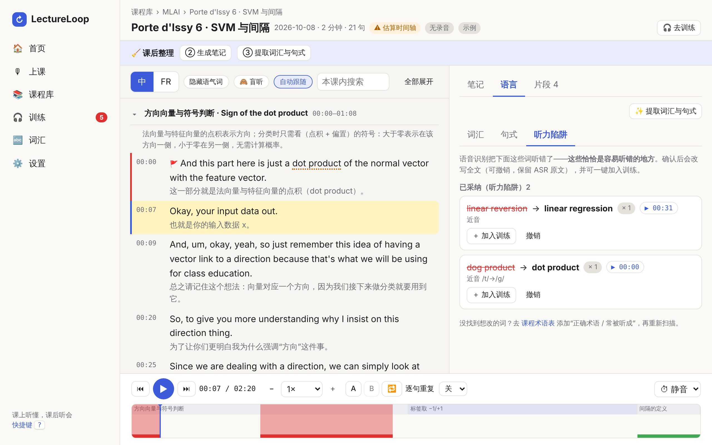
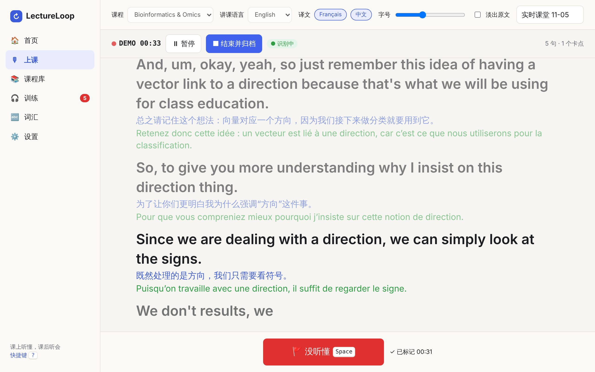
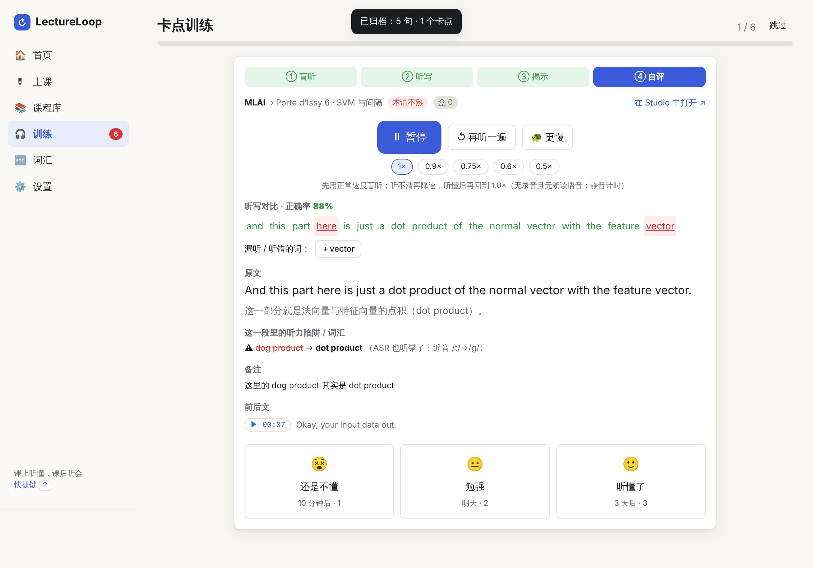

# LectureLoop · 课堂回环

> 把每一堂外语专业课，变成可以反复精听的专业听力教材——**课上听懂，课后听会**。

面向留学生的课程听力辅助工具（Web 版，后续可做成浏览器插件）。与普通实时字幕工具最大的不同：**实时字幕只是入口，核心是把课堂内容长期沉淀为精听素材，并把"没听懂的地方"变成定向训练**。支持英语 / 法语 / 中文。

| 文档 | 内容 |
|---|---|
| [docs/01-PRD.md](docs/01-PRD.md) | 产品需求：背景、真实样本研究、用户、目标与指标、用户故事、功能/非功能需求、优先级、ASR/翻译/Claude 选型与成本 |
| [docs/02-product-design.md](docs/02-product-design.md) | 产品设计：信息架构、核心流程、页面原型、交互细则、视觉规范 |
| [docs/03-frontend-plan.md](docs/03-frontend-plan.md) | 前端技术方案：选型对比、分层架构、目录、路由、数据模型、关键模块、插件演进 |
| [app/](app/) | 可运行的 MVP 代码 |



---

## 快速开始

需要 Node.js ≥ 20，以及桌面版 Chrome / Edge（实时识别依赖浏览器的 Web Speech API）。

```bash
cd lectureloop/app
```

```bash
npm install
```

```bash
npm start
```

打开 <http://127.0.0.1:8787>。首次打开会自动加载两门**示例课程**（取自真实课堂转录的短摘录，保留了真实的 ASR 错误），可以直接体验全部流程；不需要麦克风时可用"上课 → 演示课堂"。

### 接入 Claude / Google 翻译（可选）

```bash
cp .env.example .env
```

在 `.env` 里填写 `ANTHROPIC_API_KEY`（以及可选的 `GOOGLE_TRANSLATE_API_KEY`），重启 `npm start`。不填也能用：笔记、词汇会使用**离线版**（界面会明确标注），实时译文在没有翻译服务时只显示原文（演示课堂自带参考译文）。

| 变量 | 默认值 | 说明 |
|---|---|---|
| `ANTHROPIC_API_KEY` | — | Claude 密钥（只保存在服务端，浏览器永远拿不到） |
| `CLAUDE_MODEL` | `claude-opus-5-5` | 笔记归纳、语言拆解使用的模型 |
| `CLAUDE_MODEL_FAST` | 同 `CLAUDE_MODEL` | 实时翻译（无 Google 时）使用的模型。**建议设为 `claude-haiku-5-5`**：更快，成本约为 Google 翻译的 1/70（见 PRD §9.3） |
| `CLAUDE_SERVER_FALLBACK` | 开启 | 已默认启用服务端 `fallbacks: "default"`：安全分类器误拒时由 API 自动换模型重试（Haiku 不支持，会自动不带）。设为 `off` 可关闭 |
| `GOOGLE_TRANSLATE_API_KEY` | — | Google Cloud Translation（Basic v2）。配置后实时翻译优先使用它 |
| `TRANSLATE_PROVIDER` | `auto` | `auto` / `google` / `claude` |
| `PORT` / `HOST` | `8787` / `127.0.0.1` | 默认只监听本机，避免他人通过局域网使用你的密钥 |

### 开发与测试

```bash
npm run dev:mock
```

用本地**模拟的** Claude 与 Google 接口启动（输出为占位内容），用于无密钥联调 AI 流程。

```bash
npm test
```

运行领域层单元测试（断句、时间轴估算与锚点、docx 解析、纠错、SRS、听写对比等）。设置 `SAMPLES_DIR=<存放 docx 的目录>` 可额外用你的真实转录跑一遍。

---

## 功能一览（MVP）

| 模块 | 你能做什么 | 位置 |
|---|---|---|
| **实时听课** | Web Speech 实时字幕 + 0–2 种译文（英/法/中互译）；同步录音，句子带真实时间戳；**原文淡出**（按住 H 才显示）；按 `Space` 一键标"没听懂"（最近约 15 秒）；结束即归档；30 秒自动存草稿 | 上课 |
| **课程素材库** | 学期 › 课程 › 课时 › 片段（Part）；导入 `.docx`（语音备忘录导出）/ `.txt` / `.srt` / `.vtt` + 可选录音；从文件名识别日期与课程；跨课程全文搜索并直达那一句 | 课程库 |
| **笔记归纳** | 摘要笔记 / 原文对照 / 我的笔记三视图；Claude 生成概览、Part 摘要、要点、概念、公式（含口述）、老师强调、待问问题，**每条都能 ▶ 回听原话**；导出 Markdown | 课时 › 笔记 |
| **精听素材** | 录音 / 朗读 / 静音计时三种播放引擎；0.5×–2× 变速不变调；A-B 循环、逐句重复 N 遍；时间轴显示 Part、卡点、片段、语速密度，**拖拽框选**即可标卡点或存为带标签的片段 | 课时 › 播放条 |
| **语言拆解** | 专业词汇（三语释义 + 例句回听 + "常被听成"）、讲者句式（定义/强调/对比/因果…）及扩展例句；导出 Anki（TSV） | 课时 › 语言、词汇 |
| **听力陷阱** | 把 ASR 听错的术语（如 `dog product → dot product`）列出来逐条确认；采纳后改写全文、保留原文、可撤销；**一键加入训练** | 课时 › 语言 › 听力陷阱 |
| **卡点训练** | 到期队列：① 盲听（循环 + 降速）→ ② 听写（词级对比）→ ③ 揭示（原文/译文/陷阱/前后文）→ ④ 自评；Leitner 间隔重复 | 训练 |

快捷键在任意页面按 `?` 查看。Studio 常用：`Space` 播放、`← →` 换句、`L` 循环当前句、`[ ]` 变速、`M` 标卡点、`H` 盲听。

| 上课：实时字幕 + 中/法双译文 + 一键"没听懂" | 卡点训练：听写对比 → 揭示 → 自评 |
|---|---|
|  |  |

## 用你自己的语音备忘录转录

1. 课程库 → 导入 → 选择 `.docx`。文件名或首行（如 `1008-bioinfo & omics_ Porte d'Issy 5`）会自动识别为 课程 `bioinfo & omics`、日期 `10-08`。
2. 语音备忘录导出的转录**没有时间戳**，时间轴先按语速估算（页头显示"⚠ 估算时间轴"）。
3. 在课时页点这个徽标 → **绑定录音**；播放到某句时悬停该句点 **⚓**，把"当前播放位置"设为这句的起点。每 10–15 分钟加一个锚点即可，锚点之间按词数自动插值。
4. 点"课后整理"的三个按钮：确认术语纠错 → 生成笔记 → 提取词汇与句式。

## 目录结构

```
lectureloop/
├─ docs/                 PRD / 产品设计 / 前端方案 / 截图
└─ app/
   ├─ server.js          静态托管 + /api/config /api/translate /api/ai/notes /api/ai/language
   ├─ server/            claude.js（官方 SDK：结构化输出 + 流式 + 拒答处理）· ai.js（提示词/Schema/校验）· translate.js · env.js
   ├─ tools/             mock-api.mjs、dev-mock.mjs（无密钥联调）
   ├─ tests/             domain.test.mjs（node:test）
   └─ public/            无构建前端：Preact + htm（vendored，离线可用）
      └─ js/  lib/（领域逻辑，可在 Node 测试）· components/ · views/ · store.js · db.js
```

## 隐私与合规

- 录音、转录、卡点**只保存在本机浏览器**（IndexedDB）。调用 Claude / 翻译时只发送**文本**，从不发送音频。
- 浏览器的实时识别（Web Speech）可能由浏览器厂商的云服务处理语音；需要完全本地时请改用"导入转录"。
- 开始课堂录音前，请确认已获得授课教师 / 学校的许可（首次录音时应用会要求确认）。

## 已知限制（诚实清单）

- **没有用真实 Claude 密钥联调过**：开发环境里没有可用密钥。请求形状（流式、`output_config` 结构化输出、`fallbacks` beta 头、拒答处理）已用本地模拟接口端到端验证，但提示词的实际输出质量需要你填入密钥后检验。
- Web Speech 对专业术语和口音的识别有限，且没有词级时间戳；这正是"听力陷阱 + 课程术语表"要弥补的。V1 计划接入云端流式 ASR，以及课后用 Whisper 类服务重转写拿到真实时间戳。
- 估算时间轴需要录音 + 锚点校准才精准；没有录音时"朗读 / 静音计时"引擎只用于对照阅读与演示，不是真实课堂声音。
- 浏览器内置翻译（Chrome Translator API）作为最后一级降级，属实验性。
- Firefox 不支持实时识别（可以导入与练习）；暂无真实波形、多端同步、浏览器插件（见 PRD 路线图）。

---

<sub>本项目的 PRD 基于产品负责人提供的两份真实课堂转录做了定量分析：约 2.9 万词、无时间戳；术语级 ASR 错误集中在核心概念上（例如 Gini 一词至少有 7 种误听写法）。</sub>
