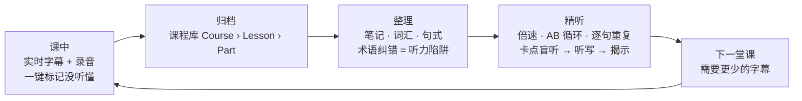
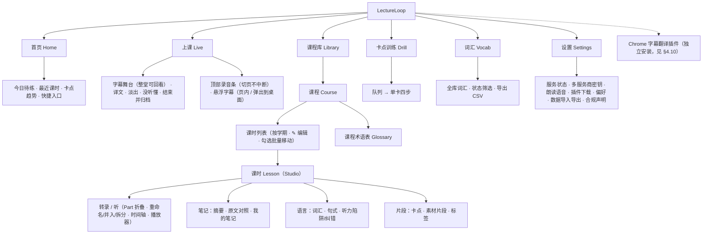
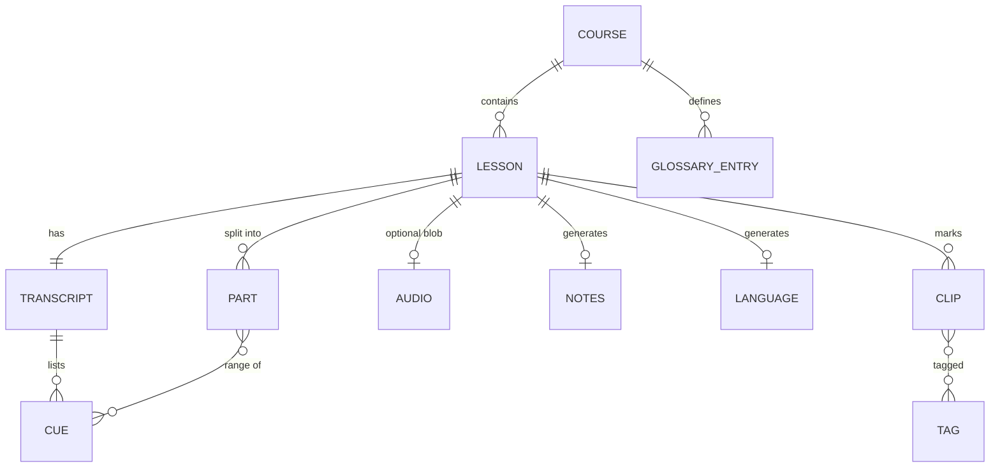
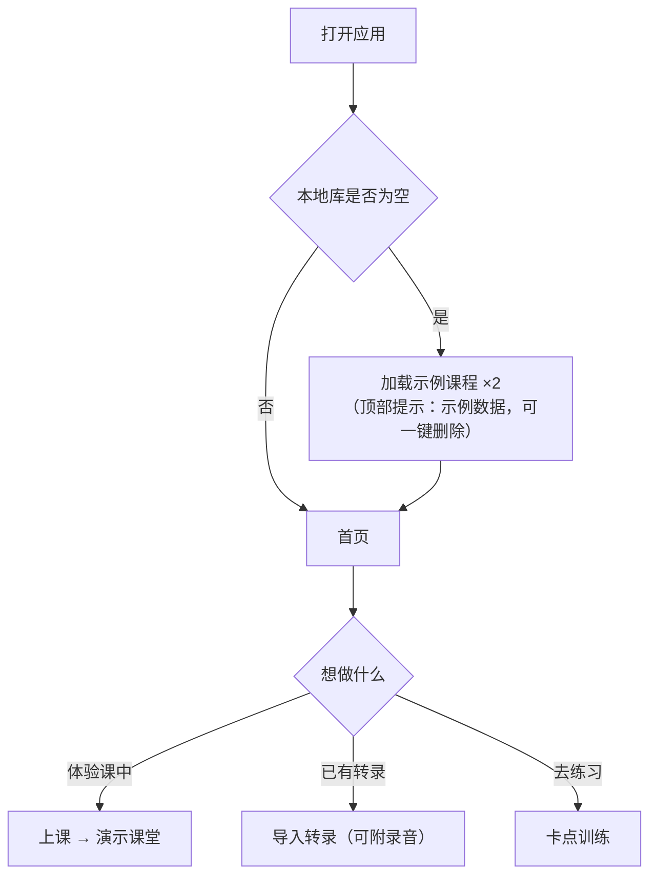
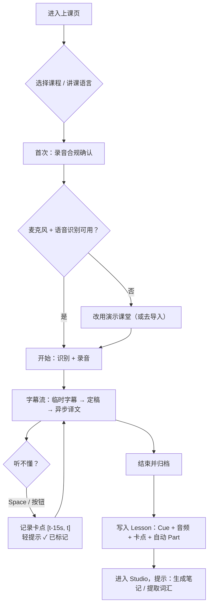
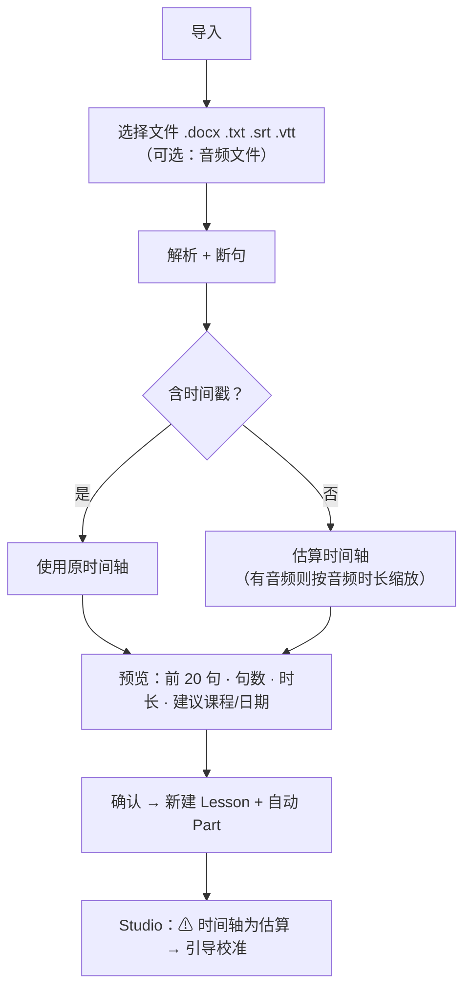
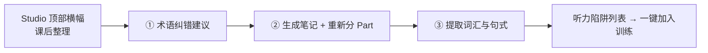
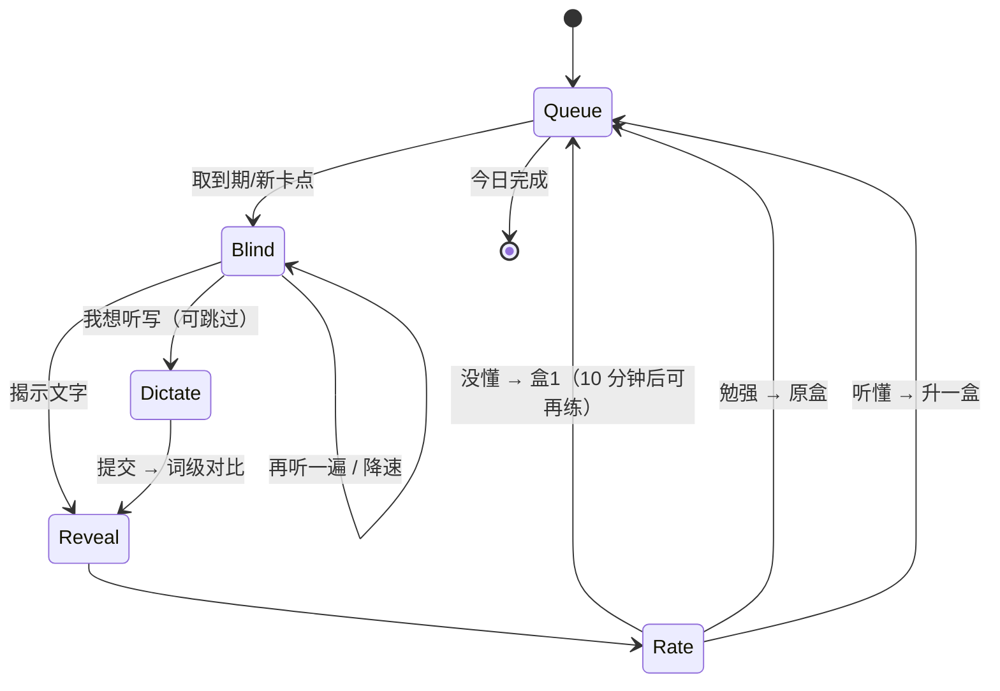
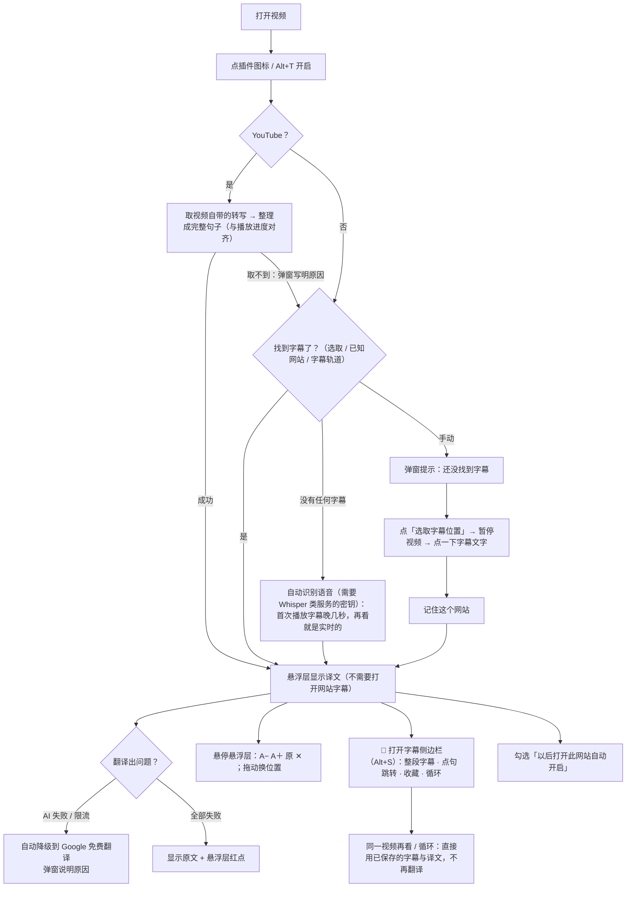

# LectureLoop 产品设计文档

| 项目 | 内容 |
|---|---|
| 版本 | v0.2（2026-11-12），对应 [PRD v0.2](./01-PRD.md) |
| 范围 | 信息架构 · 页面流程 · 低保真原型 · 交互设计 · 视觉规范（v0.2 新增：后台录制与悬浮字幕、课程库编辑、**Chrome 字幕翻译插件**的界面与流程，见 §3.6、§4.10） |
| 设计主张 | **采集要轻，练习要重**；字幕是脚手架，不是目的 |

---

## 1. 设计总览

### 1.1 一条主线：课堂回环（The Loop）



所有页面的取舍都服务于箭头 **B → C → D**：实时（A）是入口，精听（D）才是留存与价值所在。

### 1.2 五条体验原则（落到界面上）

| 原则 | 界面落点 |
|---|---|
| **轻标记** | 课中只有一个大按钮 +`Space`；原因/标签课后再补，标记当下不弹窗 |
| **字幕即脚手架** | Live 的"淡出原文"；Studio 的"盲听 H 键"；Drill 默认隐藏文字 |
| **转录不可全信** | 被纠错的词带虚线下划线，悬停显示"ASR 原文 → 纠正"，一键撤销 |
| **时间要诚实** | 估算时间轴在页头常驻 ⚠ 徽标；校准后变为"已校准" |
| **永不空白** | 每个失败路径都有降级：无密钥→离线摘要；无录音→TTS/计时器；无麦克风→演示课堂 |

---

## 2. 信息架构

### 2.1 站点地图



### 2.2 对象关系



### 2.3 导航规则

- 桌面：左侧固定侧栏（图标+文字）；"卡点训练"显示**到期数量徽标**。
- 移动：底部 5 项标签栏（首页/上课/课程库/训练/更多）；Studio 内部用顶部分段切换（转录/笔记/语言/片段），播放条固定在底部。
- 面包屑始终可回退：`课程库 › MLAI › 10-08 SVM`。
- 深链接：`#/lesson/<id>?t=1234` 直达某时间点（用于搜索结果、笔记锚点、训练卡返回）。

---

## 3. 核心流程

### 3.1 首次使用



### 3.2 课中（Live）



**关键细节**
- 译文失败 → 该句只显示原文，右上角出现一次性灰色提示，不弹窗。
- 识别被浏览器终止 → 自动重连，状态条短暂显示"重连中…"。
- 每 30 秒落盘草稿；意外关闭后再次进入上课页，提示"恢复上次未归档的课堂？"。
- **后台录制**：录音会话不属于"上课"页面。离开上课页后，所有页面顶部出现常驻**录音条**（● 时间 · 暂停 · 回到上课页）；切到别的浏览器标签也不停（识别结束立即重启、不依赖定时器；录音期间屏幕常亮；关闭页面前提示）。
- **整堂回看**：字幕舞台保留全部字幕并带时间戳；在底部时自动跟随最新，**一旦上滑就停止跟随**，右下角出现"↓ 回到最新（N 条新字幕）"，点一下回到底部。最新两行突出，更早的淡出。
- **连续讲课不卡等**：老师不停顿时，稳定的前半句会提前出现并立即翻译，不必等整段说完（见 PRD FR-1.15）；译文按到达顺序回填，不重排已显示的行。
- **悬浮字幕**：开启后页内出现悬浮块（切换页面也在）；可点"弹出到桌面"浮在其他软件之上。详见 §4.2。

### 3.3 导入已有转录



### 3.4 课后一次性处理（"整理三连"）



顺序即价值递增：先纠错（让后续 AI 输入更干净），再摘要，再拆解。三步彼此独立，任一失败不影响其他。

### 3.5 卡点训练状态机



### 3.6 看剧 / 看网页视频：字幕翻译插件（独立于上面的课堂主线）



**设计要点**
- **来源有先后，且不混用**：转录（YouTube 转写 / 语音识别）就绪后，不再退回读屏幕字幕——两套断句会互相打架；取不到才退回，并说明原因。
- **语音识别是兜底，不是默认的主路径**：只有"没有任何字幕"时才启动，并明确告诉用户音频会发给谁、首次播放会晚几秒。
- **默认休眠**：没开启的页面上没有任何悬浮元素，也不读取页面内容——这是对"读取所有网站数据"权限提示的回答。
- **总有出路**：找不到字幕 → 手动选取；AI 不可用 → 免费翻译；翻译全失败 → 至少显示原文并告诉用户原因，绝不留空白。
- **不需要密钥就能用**：第一次使用没有任何配置步骤；密钥是"想要更好翻译"时才出现的可选项。
- 视频里的操作（字号、显示原文、关闭）都在悬浮层上完成——全屏时工具栏弹窗够不着。

---

## 4. 页面清单与低保真原型说明

> 以下线框使用 ASCII 表达布局与信息层级，真实实现见 `app/public`。

### 4.1 首页 Home

```
┌──────────┬────────────────────────────────────────────────────────┐
│ ◉ Loop   │  早上好 👋  今天有 7 张卡点待练                              │
│          │ ┌─────────────────┐ ┌──────────────┐ ┌──────────────┐    │
│ 🏠 首页   │ │ ▶ 开始今日训练    │ │ 🎙 开始上课    │ │ 📥 导入转录    │    │
│ 🎙 上课   │ │   7 张 · 约 12 分 │ │              │ │              │    │
│ 📚 课程库 │ └─────────────────┘ └──────────────┘ └──────────────┘    │
│ 🎧 训练 7 │                                                          │
│ 🔤 词汇   │  最近课时                         卡点密度（每 10 分钟）       │
│ ⚙ 设置   │  ● MLAI · 10-08 SVM     12 卡点    ▂▃▅▆▄▃  ↓ 比上周 −24%    │
│          │  ● Bioinfo · 10-08 Trees 9 卡点                            │
│          │                                                          │
│          │  卡点原因分布  术语 ████ 语速 ███ 口音 ██ 公式 ██            │
└──────────┴────────────────────────────────────────────────────────┘
```

- 唯一主按钮：**开始今日训练**（无到期卡点时变为"去标记新卡点"）。
- 卡点密度趋势是北极星指标的可视化，而不是装饰。

### 4.2 上课 Live

```
┌ 上课 ──────────────────────────────────────────────────────────────┐
│ 课程 [MLAI ▾]  讲课语言 [English ▾]  译文 [☑中文][☐Français]        │
│ 字号 [──●──]  [☐ 淡出原文]  [演示课堂]                                │
├───────────────────────────────────────────────────────────────────┤
│ ● REC 00:12:34   [⏸ 暂停]  [■ 结束并归档]            已标记 3 处       │
│                                                                   │
│  …so we define the margin as the two parallel lines.   ← 已定稿，渐隐 │
│     我们把间隔定义为两条平行线。                                      │
│                                                                   │
│  And the idea is that all points must be correctly      ← 定稿        │
│  classified on each side.                                         │
│     而思路是所有点都必须被正确分类。                                  │
│                                                                   │
│  Okay so now if we look at the s…                       ← 临时(灰色)   │
│                                                                   │
│                  ┌───────────────────────┐                        │
│                  │  🚩  没听懂  (Space)    │                        │
│                  └───────────────────────┘                        │
└───────────────────────────────────────────────────────────────────┘
```

- **淡出原文**：原文行默认 `blur(6px)`，鼠标悬停或按住 `H` 清晰——强迫"先听后看"。
- 字幕区自动贴底滚动；用户上滚阅读时**停止自动跟随**并显示"↓ 回到最新（N 条新字幕）"（整堂字幕都保留，每行带时间戳，最新两行突出、更早的淡出）。
- **顶部录音条**（离开上课页后所有页面可见）：`● 00:12:34 · ⏸ · 回到上课页`。
- **悬浮字幕**（页内悬浮块）：
  ```
  ┌ ⠿ 悬浮字幕        [🖥 弹出到桌面] [🔓] [✕] ┐   ← 拖动这里移动；🔓 锁定后鼠标穿透
  │  …so we define the margin as the two lines   │
  │     我们把间隔定义为两条平行线                    │
  │  [A−][A＋][原][中][FR] ◐────  [🚩]             │   ← 字号 · 显示哪些语言 · 背景透明度 · 没听懂
  └──────────────────────────────────────────────┘
  ```
  右下角可缩放；位置、大小、透明度、字号都会记住。"弹出到桌面"使用 Document Picture-in-Picture（Chrome/Edge 116+）：浮在所有软件之上，但**浏览器窗口无法真正透明**，所以桌面窗口只提供大小、字号和深/浅主题。
- 大按钮在拇指区（移动端）/ 页面下方中央（桌面）。点击后按钮短暂变绿并显示"✓ 已标记 12:01"，不遮挡字幕。

### 4.3 课程库 Library

```
┌ 课程库                                   [🔍 搜索所有课堂…]  [＋ 新建课程] [📥 导入] ┐
│ 2026 秋季                                                                    │
│ ┌────────────┐ ┌────────────┐ ┌────────────┐                               │
│ │ MLAI       │ │ Bioinfo &  │ │ ＋ 新课程   │                               │
│ │ 3 课时 · 18 │ │ Omics      │ │            │                               │
│ │ 卡点        │ │ 2 课时      │ │            │                               │
│ └────────────┘ └────────────┘ └────────────┘                               │
└─────────────────────────────────────────────────────────────────────────────┘
课程详情
┌ MLAI › 课时 │ 术语表 ───────────────────────────────────────────────────────┐
│ 10-08  SVM & margins        2h00 估算 ⚠   卡点 12  笔记 ✓  词汇 ✓  [进入 ▸]  │
│ 10-01  Linear models        1h35 真实 ✓   卡点  4  笔记 ✗  词汇 ✗  [进入 ▸]  │
└────────────────────────────────────────────────────────────────────────────┘
```

- 搜索结果为"课时 · 时间点 · 高亮上下文"列表，点击进入 Studio 并从该句播放。
- 课时卡的"估算 ⚠ / 真实 ✓"是一等公民信息。
- **编辑**（v0.2）：课程卡片右上与课程页顶部有 **✎**：改名、改学期（课程立刻移到对应学期分组）、授课语言、颜色。课程页每个课时行有 **✎**：改标题/日期，并可**移动到其他课程**（下拉里有"＋ 新建课程…"）；移动后跳转到目标课程。
- **批量移动**：课程页每行有复选框，表头可全选；选中后出现横幅"已选 N 个课时 · 移动到其他课程… · 取消选择"。
- 移动课时时，转录、录音、笔记、卡点、词汇一起带走（对话框里有这句说明）。

### 4.4 课时 Studio（核心页）

```
┌ MLAI › 10-08 SVM & margins     [⚠ 时间轴为估算 · 去校准] [导出 ▾] [···]   ┐
├ 🧹 课后整理：① 纠错 8 项待确认  ② 生成笔记  ③ 提取词汇  ─────────────────── ┤
├───────────────────────────────────────────┬──────────────────────────────┤
│ 转录  [☑译文 zh] [☐隐藏语气词] [☐盲听 H]    │ [笔记] [语言] [片段 5]         │
│ ▾ Part 1 · 线性分类与方向向量  00:00–05:12   │                              │
│   00:05  …dot product of the normal vector │  摘要笔记 │ 原文对照 │ 我的笔记  │
│          dot̲ ̲p̲r̲o̲d̲u̲c̲t̲ (ASR: dog product)      │                              │
│          与特征向量的点积             🚩 ▶ ✎ │  概览                         │
│   00:12  So you just look at the sign.  ▶  │  本节介绍线性 SVM 的…          │
│ ▸ Part 2 · 间隔 margin 的定义  05:12–10:40   │  要点                         │
│ ▸ Part 3 · …                               │  • 标签用 −1/+1，便于… ▶ 05:40  │
│                                           │  公式                         │
│                                           │  y(w·x+b) ≥ 1  ▶ 口述 11:02    │
├───────────────────────────────────────────┴──────────────────────────────┤
│ ⏮ ◀句 ▶ 句▶ ⏭  00:05 / 2:00:00   速度 [1.0× ▾]  循环 [A][B][×3]  引擎 [录音▾] │
│ ▒▒▒▒▒░░░▒▒▒▒▒▒▒░░░▒▒▒▒▒▒░░░  ← Part 分段 + 语速密度                          │
│ ──────●━━━━━━━━━━━━━━━━━━━━  🚩🚩   ▇ 片段      （拖拽框选 → 标记/存片段）      │
└──────────────────────────────────────────────────────────────────────────┘
```

- **转录区**：Part 可折叠；当前句高亮并自动居中；每句行内操作（悬停显示）：`▶` 从此播放，`🔁` 循环此句，`🚩` 标卡点，`✎` 编辑，`⚓` 设为锚点，`✂` **从这句开始新片段**（片段的第一句没有这个按钮）。
- **Part 标题栏**右侧：`✎` 重命名；`↑并入上段`（标题沿用上一段、摘要合并；第一段没有）。拆分后新片段自动展开。手动调整过片段后，"重新生成笔记"不再覆盖分段。
- **Studio 顶部**标题旁有明显的 `✎ 编辑`：改标题/日期/移动课时（v0.1 只有隐藏的双击改名）。
- **纠错标识**：被纠正的词虚线下划线，悬停提示 `ASR：dog product → dot product [撤销]`。
- **右栏**三个标签页：笔记 / 语言 / 片段。
- **时间轴**（见 §5.3）。

### 4.5 笔记 Tab

```
[摘要笔记] [原文对照] [我的笔记]            生成方式：Claude · opus-5-5  [重新生成]
─────────────────────────────────────────────────────────────────────────
概览          ……三到五句话……
Part 摘要     ▸ P1 线性分类与方向向量 ……           ▶ 00:00
要点          • …… ▶ 05:40
概念          SVM（支持向量机）——……  ▶ 03:11
公式          y(wᵀx + b) ≥ 1    口述："y times w dot x plus b ≥ one"  ▶ 11:02
老师强调 ★    "Keep this in mind…" ▶ 22:40
待问问题 ❓   ……
─────────────────────────────────────────────────────────────────────────
⚠ 这是 AI 生成的摘要，请对照原文。离线版会显示"离线粗略版"。
```

- **原文对照**：左 Part 摘要、右该 Part 的原话（可播放），满足"区分原文与摘要"。
- **我的笔记**：自由 Markdown 文本区，自动保存，永不被"重新生成"覆盖。

### 4.6 语言 Tab

```
[词汇 38] [句式 12] [听力陷阱 8]
词汇卡  Gini impurity        n. 基尼不纯度 · impureté de Gini      [新▾]
        "…so I mentioned the Gini score, very similar…"  ▶ 21:08  ×6
        常被听成：Ginny's score / genie
句式卡  【强调】 Keep in mind that …        ▶ 原句 08:15
        扩展：Keep in mind that the margin depends only on the support vectors.
              记住：间隔只取决于支持向量。
陷阱    dog product → dot product  ×7   [▶ 听一听] [＋ 加入训练]
```

### 4.7 卡点训练 Drill

```
卡点训练   ① 盲听 ─ ② 听写 ─ ③ 揭示 ─ ④ 自评          今日 3 / 7
┌──────────────────────────────────────────────────────────────────┐
│ MLAI · 10-08 · Part 3     原因：[术语] [语速]     盒 2                │
│                                                                  │
│               [ ▶ 播放 / 循环中 ×3 ]                               │
│     速度  (0.75)(0.9)(1.0)       [再听一遍]  [下一档更慢]            │
│                                                                  │
│     ░░░░░░  文字已隐藏  ░░░░░░                                     │
│                                                                  │
│   [ 我想听写 ]                              [ 揭示文字 ]            │
└──────────────────────────────────────────────────────────────────┘
(听写)  ┌ 你听到了什么？ ┐ → 提交 → 词级对比：✓ the ✓ dot ✗(漏)product …  82%
(揭示)  原文 / 译文 / 本句涉及的词汇与陷阱 / 前后各一句（可播放）
(自评)  [ 😵 还是不懂 ]   [ 😐 勉强 ]   [ 🙂 听懂了 ]
```

### 4.8 导入对话框

```
导入转录
 1 选择文件   [转录文件 *.docx *.txt *.srt *.vtt]   [录音（可选）*.mp3 *.m4a *.wav]
 2 识别结果   文件名 1008-bioinfo & omics_ Porte d'Issy 5
              → 建议课程「bioinfo & omics」   日期 2026-10-08   标题 [Porte d'Issy 5]
              讲课语言 [English ▾]    句数 952 · 估算时长 79 分
              ⚠ 未检测到时间戳：将估算时间轴。绑定录音后可在 Studio 校准。
 3 预览       前 20 句…                               [取消] [导入]
```

### 4.9 设置

- **服务状态**：AI ✓/✗（显示服务商与模型）、翻译 ✓/✗、浏览器识别 ✓/✗、浏览器内置翻译 ✓/✗；每项附"如何开启"一行说明。
- **API 密钥**：**一个输入框**，粘贴即自动识别服务商（格式有歧义时逐个探测）；可保存多个，并分别指定"笔记/词汇"和"实时翻译"用哪个、选模型、测试连接。除 Anthropic 外标"实验性"（未经真实密钥验证）。
- **朗读语音**：列出系统语音并按质量分档（★★ 优秀 / ★ 良好 / ⚠ 较差 / ✕ 不推荐）；新奇/机器人腔语音直接排除；"自动"只在有自然语音时启用；可试听。
- **Chrome 字幕翻译插件**：下载 zip + 四步安装说明（解压 → `chrome://extensions` → 开发者模式 → 加载已解压的扩展程序）。
- **偏好**：默认讲课语言、默认译文、字号、淡出默认值、录音时保持屏幕常亮。
- **数据**：导出 JSON（不含音频）、导入 JSON、清空数据（二次确认）、**导出识别日志**（字幕丢句/时间对不上时发给开发者排查，只含识别文字与时间）。
- **合规声明**：录音需教师/学校许可；数据仅本地。

### 4.10 Chrome 字幕翻译插件

**悬浮层**（在视频画面上，Shadow DOM，全屏时挂入全屏元素）

```
┌ 视频 ──────────────────────────────────────────────────┐
│                                                         │
│            [A−][A＋][原][✕]      ← 悬停才出现             │
│        ┌─────────────────────────────┐                  │
│        │ 我不知道你想要什么。            │ ← 译文（粗体） │
│        │ (second language …)          │ ← 第二译文（黄）│
│        └─────────────────────────────┘                  │
│        Je ne sais pas ce que vous voulez.  ← 网站自带字幕 │
└─────────────────────────────────────────────────────────┘
```
- 默认位置在网站字幕**上方**（底边约在画面高度的 80%）；勾选"隐藏网站自带字幕"后改到底部（约 93%），并同时显示原文。
- 拖动换位置（记住）；右上角红点 = 翻译失败（悬停看原因，此时显示原文）。
- 字号 = 画面高度的 4.5% × 缩放系数；背景深浅可调；文字带描边，亮暗背景都清晰。

**弹窗**（宽 340px）

```
┌ LectureLoop 字幕翻译          [●━ 开关] ┐
│ www.youtube.com                         │
│ ☐ 以后打开 www.youtube.com 自动开启      │
├─────────────────────────────────────────┤
│ ✔ 字幕来源：YouTube 转写（法语 · 自动生成） │
│   已翻译 23 句 · 引擎：Google 免费翻译     │
├─────────────────────────────────────────┤
│ 字幕语言 [自动判断▾] → 翻译成 [中文▾]      │
│ 再加一种译文（可选） [（无）▾]             │
├─────────────────────────────────────────┤
│ ☐ 同时显示原文   ☐ 隐藏网站自带字幕        │
│ ☑ YouTube：用视频自带的转写（推荐）          │
│ ☑ 没有字幕时自动识别语音                    │
│ 字号 ──●──   背景深浅 ──●──               │
│ [选取字幕位置]   [重置位置]                │
├─────────────────────────────────────────┤
│ 翻译引擎 [自动（有 AI 密钥用 AI，否则…）▾]  │
│ 还没有 AI 密钥——现在用的是免费的 Google 翻译 │
│ （质量够看，但不如 AI 贴合语气）。设置密钥   │
└─────────────────────────────────────────┘
```
状态块有三种色：绿（正常）、橙（还没找到字幕 / 已降级）、红（翻译出错）。不支持的页面（浏览器内部页、应用商店）开关置灰并说明原因。

**字幕侧边栏**（Chrome 侧边栏；深色；`📖 字幕侧边栏` / Alt+S 打开；跟随当前标签页）

```
┌ 字幕  单词  收藏 3                                  ⚙ ┐
│ 视频标题…                                             │
│ ☑原文 ☑译文 ☑跟随播放  [翻译全部（12）]   13 句        │
├───────────────────────────────────────────────────────┤
│ Je ne sais pas ce que vous voulez.            0:02    │
│ 我不知道你想要什么。                                     │
├───────────────────────────────────────────────────────┤
│▌Je vais chez moi, merci.        ← 当前句（紫色竖线）0:10│
│▌我回家，谢谢。                     [▶][🔁][☆]（悬停）    │
├───────────────────────────────────────────────────────┤
│ Qu'est-ce que vous faites ici ?   ← 收藏的词按颜色显示   │
│                                                       │
│ ┌ chez ─────────────────────────── ✕ ┐ ← 单词卡（点词） │
│ │ 在……家（结合这句话的译文）              │
│ │ Je vais **chez** moi, merci.         │
│ │ [不会●红][模糊●黄][会了●绿]            │
│ └──────────────────────────────────────┘
└───────────────────────────────────────────────────────┘
```
- **标题栏**：视频标题 + 字幕来源（`YouTube 转写（法语 · 自动生成）` / 语音识别）+ `⟳ 重新整理`（重新取一遍转写并整理）。
- **字幕**：每句一个色块；点这一句 = 跳到这里播放；单词可点；☆ 展开 4 个颜色点（红 / 黄 / 绿 / 蓝"好句"），整行带色（左侧竖线 + 淡底色）；🔁 循环这一句；还没有译文的显示"…"。
- **单词**：本视频的词频表（可隐藏常见词）；筛选"全部 / 未收藏 / 已收藏"；每个词前有颜色点。
- **收藏**：全部视频的收藏；按"单词 / 句子"与颜色筛选；▶ 跳转、🗑 删除、**导出 TSV**。颜色含义写在筛选条上：不会（红）· 模糊（黄）· 会了（绿）· 好句（蓝）。
- 颜色的语义：词用红 / 黄 / 绿表示掌握程度（红 = 不会，需要重点记；绿 = 会了，淡化），句子可再用蓝色表示"好句 / 备用"。红、黄的词在字幕里带波浪下划线，扫一眼就能看到生词。

**设置页**（独立标签页）：粘贴密钥 →"验证并保存"（识别服务商、读 `/models`）→ 已保存列表（选用、选模型、测试、删除）；"免费翻译"卡片可测试；隐私说明。没有默认模型的服务商（自定义地址、OpenRouter）保存后提示"请选择模型"。

---

## 5. 交互设计细则

### 5.1 快捷键

| 场景 | 键 | 动作 |
|---|---|---|
| **Studio** | `Space` | 播放 / 暂停 |
|  | `←` `→` | 上一句 / 下一句 |
|  | `R` | 重播当前句（再按一次循环 ×N） |
|  | `L` | 循环当前句开/关 |
|  | `[` `]` | 降速 / 升速（阶梯：0.5 0.6 0.75 0.9 1.0 1.25 1.5 2.0） |
|  | `M` | 把当前句（或框选区间）标为卡点 |
|  | `A` `B` | 设 A 点 / B 点（再按 `Esc` 清除循环） |
|  | `H` | 盲听（隐藏转录文字）开/关 |
| **Live** | `Space` / `M` | 没听懂 |
|  | `H` | 按住显示淡出原文 |
| **Drill** | `Space` | 再听一遍 |
|  | `S` | 降一档速度 |
|  | `Enter` | 揭示 / 提交听写 |
|  | `1` `2` `3` | 自评：没懂 / 勉强 / 听懂 |
| **悬浮字幕** | 🚩 按钮 | 没听懂（鼠标操作；悬浮块内不抢键盘焦点） |
| **插件（Chrome）** | `Alt+T` | 开 / 关当前标签页的字幕翻译（可在 `chrome://extensions/shortcuts` 修改） |
|  | `Alt+S` | 打开字幕侧边栏 |
| 全局 | `?` | 快捷键面板 |

输入框聚焦时快捷键不生效（避免打字时误触发）。

### 5.2 标记卡点的交互

| 入口 | 行为 | 范围规则 |
|---|---|---|
| Live：`Space` | 立即标记，无弹窗 | `[当前句起点 − 前两句, 当前时刻]`，约 15 秒 |
| Studio：`M` / 🚩 | 标记当前句，轻提示"已标记，撤销" | 当前 Cue（可再扩展 ±1 句） |
| 时间轴框选 | 弹出浮层：**标为卡点 / 存为片段+标签 / 设为循环** | 框选区间，吸附到句边界 |

- 标记后**不打断播放**；浮层 5 秒内未操作自动收起，标记已生效。
- 原因可在"片段"Tab 补填（语速/口音/术语/公式口述/句式复杂/音质/其他）。
- 所有标记都支持 5 秒内撤销（Toast 上的"撤销"）。

### 5.3 时间轴交互

| 元素 | 视觉 | 交互 |
|---|---|---|
| Part 分段 | 交替底色块，悬停显示标题 | 点击跳到片段起点 |
| 语速密度 | 每 30 秒一个柱（词数） | 低谷=停顿/板书，高峰=语速快——找卡点的线索 |
| 卡点 | 红色段 | 点击选中并列出 |
| 素材片段 | 按标签色的段 | 点击跳转；右键/长按编辑 |
| 播放头 | 竖线，拖动即 seek | — |
| 循环区 | 半透明高亮 + A/B 把手 | 拖把手微调（吸附句界，按住 Alt 取消吸附） |
| 框选 | 在空白处按下拖拽 | 出现浮层（见 §5.2） |

### 5.4 倍速与循环

- 速度阶梯 `0.5 / 0.6 / 0.75 / 0.9 / 1.0 / 1.25 / 1.5 / 2.0`；音频引擎用 `preservesPitch`。
- "逐句重复 ×N"：每句播放 N 遍后自动进入下一句；N∈{1,3,5,∞}。
- TTS 引擎下速度通过 `utterance.rate` 实现；静音计时器引擎按倍率推进时间轴。

### 5.5 估算时间轴的校准（锚点）

1. 页头徽标 `⚠ 估算` → 点击进入**校准模式**（有录音时）。
2. 播放到讲者说出某句时，点该句的 `⚓`："把当前播放位置设为此句起点"。
3. 锚点之间按词数线性插值；锚点以 📌 显示；建议每 10–15 分钟加一个。
4. 校准后徽标变为 `已校准 · n 个锚点`；误差仍可再加锚点缩小。

### 5.6 状态矩阵（所有页面必须有）

| 页面 | 空 | 加载 | 错误 | 降级 |
|---|---|---|---|---|
| 首页 | 引导卡"导入或开始上课" | 骨架 | — | — |
| Live | 说明+演示课堂入口 | — | 麦克风被拒/不支持识别 → 文案+演示入口 | 译文失败→仅原文 |
| 课程库 | 空库引导 | 骨架 | — | — |
| Studio | 无音频→提示"可绑定录音" | 转录分块渲染 | 解析失败→可重新导入 | 无录音→TTS/计时器 |
| 笔记 | "尚未生成" + 生成按钮 | 进度提示（可取消） | 展示原因+离线版按钮 | AI 失败→离线粗略版 |
| 训练 | "今日已清空 🎉" | — | — | 无录音→TTS |
| 课程库编辑 | — | — | 标题/课程名为空→保存按钮禁用 | 移动时目标课程不存在→在同一对话框里新建 |
| 插件侧边栏 | 没有字幕 → "还没有字幕。打开有字幕的视频，点插件图标开启…"；没有收藏 → 引导（点 ☆ 收藏句子，点单词收藏单词） | 字幕轨道一次性载入；网站字幕边播边出现 | 译文缺失显示"…"；翻译全部失败 → 悬浮层同款错误提示 | 没有译文时仍可看原文、收藏、循环 |
| 插件悬浮层 | 未开启→页面上无任何元素；已开启但没字幕→不显示 | 译文还没回来→先显示原文（或网站自带字幕） | 翻译失败→显示原文 + 红点；弹窗说明原因 | AI→Google 免费→Chrome 内置→仅原文 |

### 5.7 无障碍

- 所有按钮有 `aria-label`；时间轴提供键盘左右微调；对比度 ≥ 4.5:1。
- 当前句高亮不仅靠颜色（同时有左侧竖线）。
- 尊重 `prefers-reduced-motion`；深色模式跟随系统。

---

## 6. 视觉规范

### 6.1 设计语言

安静、纸质感、长时间阅读不累。低饱和底色 + 一个靠谱的靛蓝主色；**红色只留给"卡点"**，使其一眼可见。

### 6.2 色彩令牌

| Token | 浅色 | 深色 | 用途 |
|---|---|---|---|
| `--bg` | `#f6f5f1` | `#14161a` | 页面底 |
| `--surface` | `#ffffff` | `#1c1f25` | 卡片 |
| `--ink` | `#1c1d21` | `#e8e9ec` | 正文 |
| `--muted` | `#6a6d76` | `#9a9ea8` | 次要 |
| `--line` | `#e4e2da` | `#2b2f37` | 分割线 |
| `--accent` | `#3b5bdb` | `#7c93ff` | 主操作、播放头 |
| `--stuck` | `#e03131` | `#ff6b6b` | 卡点（专属） |
| `--ok` | `#2f9e44` | `#51cf66` | 通过/已掌握 |
| `--warn` | `#e8890c` | `#ffa94d` | 估算/提示 |
| `--hl` | `#fff3bf` | `#3d3a1f` | 当前句/搜索高亮 |

标签调色盘（8 色，色盲友好顺序）：靛 · 青 · 绿 · 黄 · 橙 · 粉 · 紫 · 灰。

### 6.3 字体与间距

- 系统字体栈（离线可用）：`system-ui, -apple-system, "PingFang SC", "Noto Sans SC", sans-serif`；时间码用等宽 `ui-monospace`。
- 转录正文 16px / 行高 1.6；Live 字幕 28–44px 可调。
- 间距 4 的倍数；圆角 10px（卡片）/ 999px（徽标）。

### 6.4 组件清单

按钮（主/次/幽灵/危险）· 徽标（估算/真实/AI/离线）· 标签 Chip · 分段切换 · 模态框 · Toast（可撤销）· 浮层（框选操作）· 时间轴 · 转录行 · 词汇卡 · 句式卡 · 训练卡 · 空状态。

---

## 7. 文案要点（Microcopy）

| 场景 | 文案 |
|---|---|
| 估算徽标 | "时间轴为估算：这份转录没有时间戳。绑定录音并加几个锚点，就能精准精听。" |
| 离线摘要 | "离线粗略版（未使用 AI）。填写 Claude 密钥后可生成完整笔记。" |
| 标记成功 | "✓ 已标记 12:01　撤销" |
| 模型拒答 | "AI 这次没有返回结果（原因：…）。已为你生成离线版，可稍后重试。" |
| 录音合规 | "请确认你已获得授课教师/学校对课堂录音的许可。录音仅保存在本机浏览器中。" |
| 训练完成 | "今天的卡点清空了。下一次到期：明天 · 3 张。" |
| 插件·没找到字幕 | "还没找到字幕。请先在播放器里打开字幕；没有反应就点“选取字幕位置”。" |
| 插件·选取提示 | "先暂停视频，让字幕停在屏幕上，然后点击字幕文字（Esc 取消）" |
| 插件·降级 | "AI 翻译失败（…），已改用 Google 免费翻译" |
| 插件·限流 | "Google 免费翻译被限流，请稍后再试或换用 AI 密钥" |
| 插件·侧边栏空状态 | "还没有字幕。打开有字幕的视频，点插件图标开启“字幕翻译”，这里就会列出识别到的全部字幕。" |
| 插件·转写取不到 | "没取到 YouTube 转写（原因），暂时读取屏幕上的字幕。" |
| 插件·没有语音识别服务 | "这个视频没有字幕。要自动识别语音，需要在设置里添加支持语音转写的密钥（OpenAI / Groq，或自定义 Whisper 接口）。" |
| 插件·语音识别中 | "🎙 语音识别中（服务 · 模型）· 已识别 N 句。首次播放字幕会晚几秒，再看就是实时的。" |
| 插件·静音 | "拿到的是静音：这个视频可能受版权保护（DRM），网页无法获取它的声音" |
| 插件·无密钥 | "还没有 AI 密钥——现在用的是免费的 Google 翻译（质量够看，但不如 AI 贴合语气）。" |
| 悬浮字幕·桌面窗口 | "浏览器窗口无法做成真正透明（系统限制），所以桌面窗口只能调大小、字号和深浅主题。" |

---

## 8. 设计验收清单

- [ ] 课中标记 ≤ 1 次按键；标记后不丢失字幕上下文
- [ ] 任意页面失败均有降级路径，无空白页
- [ ] 估算/真实时间轴在 Studio 与课程卡片上均可见
- [ ] 笔记每一条可回听；摘要与原文视觉分离
- [ ] 一张卡点训练卡在 2 分钟内可走完
- [ ] 全键盘完成 Studio 与 Drill 主要操作
- [ ] 深浅色、窄屏（≥ 360px）均无横向滚动
- [ ] 录音中切到别的页面/标签页，字幕与录音不中断；顶部录音条一键回到上课页
- [ ] 上滑可看到整堂字幕；上滑后不会被自动拉回；"回到最新"可用
- [ ] 课程/课时/片段的改名、改学期、移动、批量移动、拆分、并入都能在界面上找到入口（不依赖隐藏手势）
- [ ] 插件：未开启的页面无任何悬浮元素；开启后在没有密钥时也有译文；翻译失败时显示原文与原因，不留空白
- [ ] 插件：悬浮层在全屏下可见，拖动/字号/位置刷新后保持
- [ ] 插件（YouTube）：不开网站字幕也有译文；译文是完整句子、与说话时间吻合，停顿处不挂着上一句；取不到转写时退回读屏幕字幕且弹窗写明原因
- [ ] 插件（语音识别）：没有字幕且有 Whisper 兼容服务时自动识别；没有服务时说明原因而不是静默；再看一遍按时间准确显示且不重复识别
- [ ] 插件侧边栏：字幕全部列出且当前句高亮跟随；点句跳转、循环一句可用；收藏的词/句颜色立即显示并在刷新后保留；同一视频循环或刷新后不再产生翻译请求
